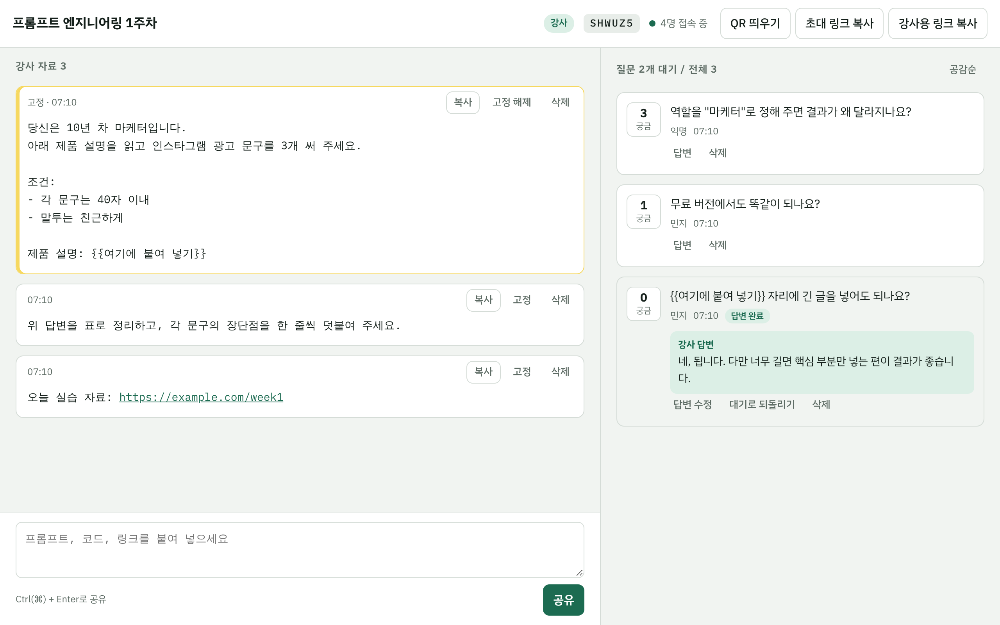
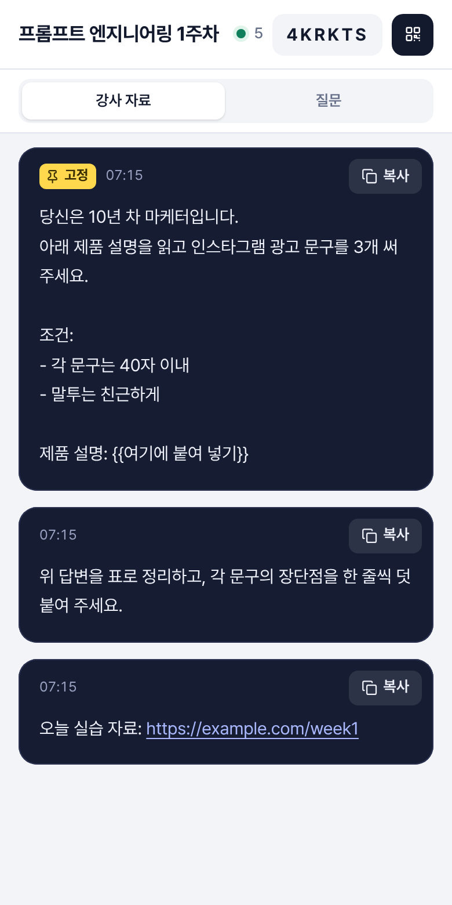
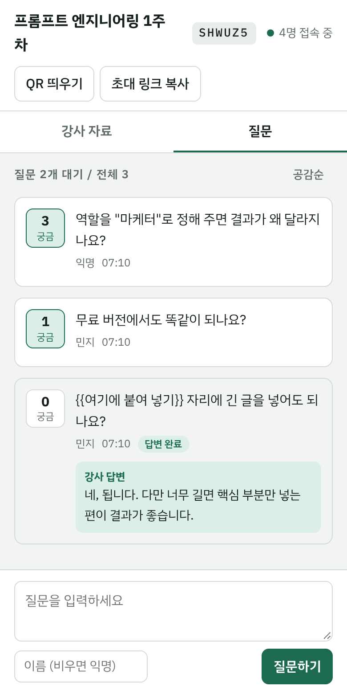
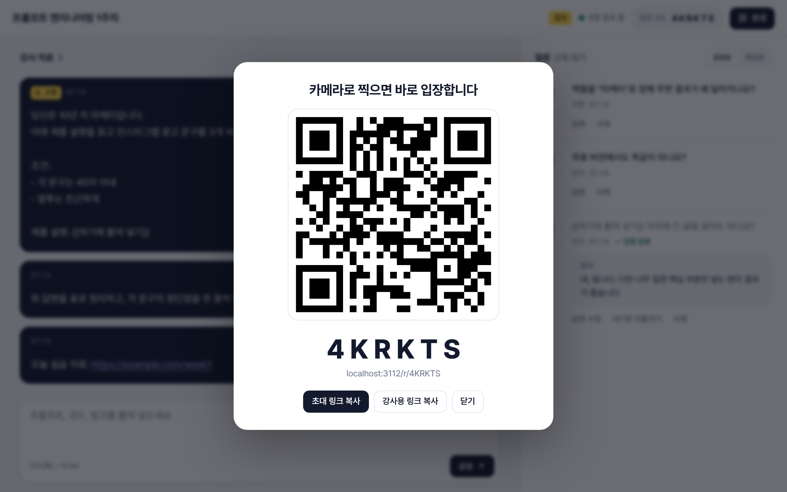

# 강의실 라이브

강의 중에 강사가 프롬프트·코드·링크를 올리면 모든 수강생 화면에 즉시 나타나고, 수강생은 가입 없이 질문을 남길 수 있는 웹앱입니다.



| 수강생: 강사 자료 | 수강생: 질문 | 초대 (QR) |
| --- | --- | --- |
|  |  |  |

## 기능

- **강사 자료**: 붙여 넣고 공유하면 실시간 전달. 수강생은 "복사" 한 번으로 프롬프트를 가져갑니다. 중요한 자료는 상단 고정.
- **질문**: 수강생이 이름 또는 익명으로 질문. 다른 수강생은 손 모양 버튼으로 공감, 공감순/최신순 정렬.
- **답변**: 강사가 답변을 달거나 "답변 완료"로 표시. 질문·자료 삭제 가능.
- **입장**: 6자리 코드, 초대 링크, 화면에 띄우는 QR 코드. 왼쪽 사이드바의 "초대"에서 한 번에 엽니다.
- 서버가 잠깐 끊겨도 화면이 자동으로 다시 연결되고, 기록은 파일에 남습니다.
- 휴대폰 화면, 다크 모드 지원.

## 실행

Node.js 18 이상만 있으면 됩니다. 설치할 패키지가 없습니다.

```bash
node server.js
```

브라우저에서 `http://localhost:3000` 을 열고 강의실을 만드세요.

- `PORT`: 포트 (기본 3000)
- `DATA_FILE`: 저장 파일 경로 (기본 `data.json`)

## 수강생이 접속하려면

수강생 기기에서 열리는 주소가 필요합니다. 둘 중 하나를 고르세요.

1. **호스팅에 올리기 (권장)**: Render에서 New Blueprint Instance로 이 저장소를 고르면 `render.yaml` 설정대로 배포됩니다. Railway, Fly.io 같은 다른 Node 호스팅도 시작 명령 `node server.js` 로 올릴 수 있습니다. 서버가 재시작돼도 기록을 유지하려면 영구 디스크를 붙이고 `DATA_FILE` 을 그 경로로 지정하세요.
2. **내 노트북에서 임시로 열기**: `node server.js` 를 켠 채로 터널을 엽니다. 강의가 끝나고 끄면 주소도 사라집니다.

   ```bash
   npx cloudflared tunnel --url http://localhost:3000
   ```

## 강사 권한

강의실을 만든 브라우저에 강사 키가 저장됩니다. 다른 기기에서 강사로 들어가려면 상단의 "강사용 링크 복사"로 받은 링크를 여세요. 이 링크는 수강생에게 공유하면 안 됩니다.

## 구조

- `server.js`: 서버 전체. 방·자료·질문 API와 실시간 전송(SSE).
- `public/index.html`: 화면 전체 (시작 화면, 강의실).
- `public/qrcode.js`: QR 생성 라이브러리 (qrcode-generator, MIT).

새 메뉴를 추가할 때는 `public/index.html` 의 `.side-nav` 안에 `.side-item` 을 늘리면 됩니다.
